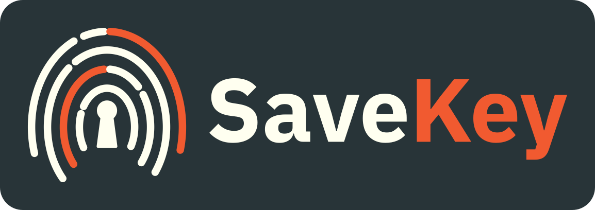

<h1 align="center"></h1>

**SaveKey is a KeePass password manager for iPhone**: a native SwiftUI app in the spirit of
**KeePassDX**. It opens, edits and saves standard KeePass `.kdbx` databases wherever they live (On
My iPhone, iCloud Drive, Dropbox, OneDrive, a Nextcloud provider and so on), so the same file keeps
working with KeePass, KeePassXC and KeePassDX on your other devices.

SaveKey is free and open-source software, licensed under the
[GNU Affero General Public License v3.0 or later](LICENSE); only the SaveKey logo is excluded (see
[License](#license)). It has no accounts, no servers, no tracking and no ads: your database never
leaves the places you keep it. See the [privacy policy](PRIVACY.md).

## Features

| Area | What's included |
|---|---|
| **Formats** | Reads KDBX 3.1, 4.0 and 4.1. Saves KDBX 4.x. Supports AES-256 and ChaCha20 encryption, Argon2d, Argon2id and AES-KDF key derivation, and gzip compression. |
| **Unlocking** | Master password and/or key file (XML v1/v2 `.key`/`.keyx`, 32-byte, 64-hex or any file). Face ID / Touch ID quick unlock. Read-only mode, remembered for each database. |
| **Browsing** | Nested groups, search across all entries (title, username, URL, notes, tags, custom fields), sorting, custom icons, expired-entry markers. |
| **Appearance** | Settings › Display › Appearance: Automatic (follows the iPhone), Light or Dark. Dark mode uses the logo's slate colour (#283438) for screens, with slightly lighter slate rows. All built-in icons (databases, folders, entries and the icon collection) use the logo colours: an orange (#f15a30) symbol on a slate tile in light mode, a slate symbol on an orange tile in dark mode. |
| **Languages** | English, Deutsch, Español, Français, Italiano, Português (Brasil) and Português (Portugal). SaveKey follows the iPhone's language; to use a different language in SaveKey only, choose it in SaveKey's Settings › Language or in iPhone Settings › Apps › SaveKey › Language (the same setting), then close and reopen SaveKey. Password AutoFill follows the same choice. New databases get their starter folders in the chosen language. |
| **Website icons** | Optional (Settings › Website icons, off by default). Entries with a web address show that site's logo, e.g. the Netflix logo on a Netflix entry; popular services are also recognised by title. Logos are downloaded only when an entry is shown, straight from the website over HTTPS without cookies (only the site's address is used), and kept on the device. Local and private addresses are never contacted, and custom icons take priority. AutoFill shows logos the app has already downloaded. |
| **Entries** | Copy username/password/URL with auto-clearing clipboard, reveal with colour-coded characters, strength meter, protected custom fields, notes, tags, expiry, attachments (preview with Quick Look, share, add, remove), full history with restore. |
| **One-time passwords** | TOTP (SHA-1/256/512), HOTP and Steam Guard with a live countdown. Set up via QR scan, an `otpauth://` link or manual entry. Reads KeePassXC (`otp`), KeePass 2.47+ (`TimeOtp-*`/`HmacOtp-*`), legacy KeePassXC and KeeOtp formats. |
| **Editing** | Create, edit, duplicate, move and delete entries and groups. Recycle Bin. 69 standard KeePass icons plus custom icons from Photos. |
| **Payment cards** | "New card" saves to the Banking folder. Scan the card with the camera (or pick photos) to read the number, holder name, valid-thru date and security code on the device, and optionally keep the front/back images. Card brand is detected automatically (Visa, Mastercard, Amex, Elo, Hipercard, Discover, Diners, JCB, UnionPay, Maestro, Mir, RuPay), and numbers are checked with the Luhn checksum. Fields match KeePassDX's card template (`Number`, `Holder`, `CVV`, `PIN`, entry expiry date), so cards open correctly there too. |
| **Secure notes** | "New note" saves to the Notes folder (created on first use; new databases include it). Entries in the Notes folder and its subfolders are notes: the note comes first, and there are no Credentials or One-time password sections. If an entry there already has a username, password, URL or one-time password, those still show, so nothing is hidden. Lists show when a note was last edited rather than its text, and AutoFill leaves notes out. Folders named "Notes", "Secure Notes", "Notas", "Notizen" or "Note" are recognised. |
| **Generator** | Character-set passwords (length 4–128, look-alike exclusion, custom include/exclude) and EFF-diceware passphrases. |
| **Database settings** | Name, description, default username, Recycle Bin, history limits, cipher, KDF and its cost (with 1-second calibration), compression, master key / key file change. |
| **Password AutoFill** | Extension that suggests entries matching the website, with search and Face ID. Optional QuickType suggestions (usernames and domains only). Copies the TOTP code after filling. |
| **Sync** | While a database is open, SaveKey checks the file every few seconds and whenever you return to the app. Changes saved elsewhere are merged in the way KeePassXC's *Merge From Database* does it, also when you save on the iPhone after the file changed. A database opened read-only simply shows the latest version. "Open from a synced folder" and "Follow in folder…" make SaveKey find the file by its name in its folder, so it keeps working when rclone, Syncthing and similar tools replace the file. Conflict copies (rclone bisync, Syncthing, Dropbox, Nextcloud, iCloud) are offered for merging. See [Syncing with KeePassXC](#syncing-with-keepassxc-on-a-computer). |
| **Security** | Auto-lock after a timeout in the background, privacy screen in the app switcher, clipboard items local-only (no Universal Clipboard) with expiry, and decrypted attachments kept in a protected temp folder that is wiped on lock. |

## Syncing with KeePassXC on a computer

SaveKey works with whatever keeps the file in sync: iCloud Drive, Dropbox, Syncthing (through
Synctrain on the iPhone), rclone and so on. A few things make it smooth:

- **Open the database with "Open from a synced folder"** (the **+** menu), or swipe a database in the
  list and choose **Follow in folder…**. SaveKey then finds the file by its name in that folder. Some
  tools don't overwrite a file but delete it and upload a new one (rclone's iCloud Drive backend does
  this), and a database opened the usual way loses track of the new file. If that happens, SaveKey says
  so and asks for the folder.
- **Read-only on the iPhone.** Turn on "Open read-only" when unlocking; SaveKey remembers it for that
  database. The open database refreshes by itself when the file changes, and SaveKey never writes to it.
- **Editing on both sides.** Changes from elsewhere are merged like KeePassXC's
  *Database › Merge From Database*: for each entry the newer version wins and the older one goes into its
  history; new entries, moves and deletions come across; and when the iPhone and the computer changed
  different entries, both changes are kept. If the file changed since SaveKey last read it, saving merges
  it first. Nothing is merged while an edit screen is open; that happens when you save.
- **Sync in both directions.** `rclone copy` only copies from the computer, so it overwrites what you
  save on the iPhone. If SaveKey sees its changes overwritten twice in a row, it stops saving back and
  warns you, keeping your changes on the iPhone. For two-way sync use `rclone bisync`, for example:

  ```
  rclone bisync ~/KeePass icloud:KeePass --conflict-resolve newer --resilient --recover
  ```

  The first run needs `--resync --resync-mode newer`. Keep KeePassXC's dated backups in a folder outside
  the synced one (KeePassXC › Settings › General › File Management › Backup destination), because bisync
  mirrors deletions too.
- **Or skip the cloud: Syncthing straight to the iPhone with
  [Synctrain](https://apps.apple.com/app/id6553985316),** a free, open-source Syncthing client for iOS.
  The iPhone then joins the same Syncthing folder as your computer (and Android phone), with no iCloud
  or rclone in between.
  - In Synctrain, sync the whole KeePass folder, or at least select the `.kdbx`, so the file is stored
    on the iPhone. A file that is only listed, not downloaded, can't be opened or saved by other apps.
  - In SaveKey, use "Open from a synced folder" and pick the folder under **On My iPhone › Synctrain**.
    Syncthing updates a file by writing a temporary copy and renaming it over the old one, so following
    the file by name is the right choice here too.
  - iOS gives Synctrain little time in the background. Open it for a moment after editing in SaveKey so
    the change goes out, and before editing so you start from the latest version. If both sides changed,
    Syncthing keeps the other version as a `.sync-conflict-…` copy, which SaveKey offers to merge.
  - Every change, deletions included, reaches all devices, so turn on file versioning for the folder in
    Syncthing on the computer, and keep KeePassXC's backups in a folder that isn't shared with the phone.
- **Conflict copies.** When both sides changed the file between two syncs, bisync keeps the newer file
  and renames the other one `Passwords.kdbx.conflict1`; Syncthing calls it
  `Passwords.sync-conflict-<date>-<time>-<device>.kdbx`. SaveKey shows such a copy at the top of the open
  database with a **Merge** button: it merges the copy, saves, and moves the copy to Recently Deleted.
  Versions that iCloud keeps aside when two devices save at once are offered the same way.
- In KeePassXC, turn on *Automatically reload the database when modified externally* (Settings › General
  › File Management) so the computer picks up changes from the iPhone too.

## Keep your signing settings between updates

Your bundle ID and team live in a small file **next to** the `SaveKey` folder, so replacing the
folder with a new version never erases them. Create `SaveKey-Signing.xcconfig` beside it:

```
DEVELOPMENT_TEAM = ABCDE12345
BUNDLE_ID_BASE = com.yourname.savekey
```

- `BUNDLE_ID_BASE`: use the same value as before. A different ID installs a second copy of the app.
- `DEVELOPMENT_TEAM`: your Team ID. If you don't know it, leave the line out and pick your team
  under Signing & Capabilities instead.

`Config/Signing.xcconfig` inside the project loads this file automatically. If you cloned the
repository, put the file next to the cloned folder; it is never committed.

## Free Apple ID? Use `SaveKey-Free.xcodeproj`

Password AutoFill needs a paid Apple Developer Program membership, so there are two projects:

| Project | Account | Includes |
|---|---|---|
| `SaveKey-Free.xcodeproj` | Free Apple ID (Personal Team) | Everything except Password AutoFill. Needs no special capabilities. |
| `SaveKey.xcodeproj` | Paid developer account | Full app plus the AutoFill extension. |

Steps for the free project:

1. Open `SaveKey-Free.xcodeproj` and select the **SaveKey** target.
2. Set a unique `BUNDLE_ID_BASE`, e.g. `com.yourname.savekey`, in `SaveKey-Signing.xcconfig`
   (see above). Free teams can't reuse an identifier someone else has registered.
3. Under **Signing & Capabilities**, choose your **Personal Team**.
4. Connect your iPhone and press Run.
5. On the iPhone, trust the developer profile in **Settings › General › VPN & Device Management**.
   On iOS 16 and later, also turn on **Settings › Privacy & Security › Developer Mode**.

Free-account limits:
- The installed app stops opening after **7 days**. Press Run in Xcode again to renew it; your
  databases and settings are kept.
- You can only have a few free-signed apps on a device at once.
- Your `.kdbx` files live in Files / iCloud Drive, not inside the app, so they're never at risk
  when the app expires.

Everything else works on the free account, including Face ID unlock, the clipboard and OTP codes.
When you upgrade to a paid account, switch to `SaveKey.xcodeproj` to get AutoFill.

## Getting it running

Requirements: a Mac with **Xcode 16 or newer**, and an iPhone on iOS 16+ (the simulator works too,
apart from Face ID and AutoFill).

1. Open `SaveKey.xcodeproj` (paid account; see above for free accounts).
2. Set your own `BUNDLE_ID_BASE` (e.g. `com.yourname.savekey`) in `SaveKey-Signing.xcconfig`
   (see above). The app group and keychain group are derived from it automatically.
3. Under **Signing & Capabilities**, pick your Team for **both** targets (`SaveKey` and
   `SaveKeyAutoFill`). Xcode registers the App Group, Keychain Sharing and AutoFill Credential
   Provider capabilities. If your account type doesn't allow one of them, a paid developer account
   is required.
4. Choose the **SaveKey** scheme and run it on your iPhone.
5. To enable AutoFill: **Settings › General › AutoFill & Passwords** → turn on **SaveKey**.

If you edit `project.yml`, regenerate the project with [XcodeGen](https://github.com/yonaskolb/XcodeGen):
`xcodegen generate`.

## Project layout

```
SaveKey.xcodeproj         full project, paid account (from project.yml)
SaveKey-Free.xcodeproj    free-account project, no AutoFill (from project-free.yml)
App/                       iPhone app (SwiftUI)
  SaveKeyApp.swift        app entry, auto-lock, privacy shield
  Views/                   database list, groups, entry detail/edit, generator, OTP, settings…
AutoFill/                  Password AutoFill credential-provider extension
Shared/                    code used by both: unlock screen, sessions, file access, languages,
                           Face ID keychain store, settings, clipboard, icons
Config/Signing.xcconfig    loads your SaveKey-Signing.xcconfig (bundle ID, team)
Branding/                  the SaveKey logo and banners: masters, the scripts that draw them and
                           the terms for using them (all rights reserved, not open source)
Shared/Localization/       translations (Localizable.strings and InfoPlist.strings per language)
Tools/Localization/        translation tables; make_strings.py writes Shared/Localization,
                           check_translations.py finds texts that still need translating
Tools/SyncCheck/           runs the file-sync code on Linux through scripted situations
.github/workflows/         CI: engine tests, sync check and translation check on every push
LICENSE                    the GNU AGPL v3 text; APP_STORE_EXCEPTION.md adds the app store permission
PRIVACY.md                 privacy policy
docs/APP_STORE.md          what publishing on the App Store will need
Packages/KeePassCore/      platform-independent KeePass engine (Swift package)
  Sources/KeePassCore/
    Crypto/                AES, ChaCha20, Salsa20, Argon2, BLAKE2b, SHA/HMAC
    Format/                KDBX reader/writer, XML mapping, key files, KDF
    Model/                 Database, KPGroup, KPEntry, Meta, merging (KeePassXC rules)
    Tools/                 password generator, TOTP/HOTP, URL matching for AutoFill,
                           payment cards (brand detection, Luhn, card-scan text parser),
                           names of sync-tool conflict copies
  Tests/                   test vectors + interop tests against real KeePass files
```

The engine uses Apple's CryptoKit and CommonCrypto on iOS (hardware-accelerated AES and SHA).
Argon2, ChaCha20 and Salsa20 are implemented in Swift. Argon2 runs lanes in parallel: 64 MiB with
2 iterations takes about 0.2 s on a laptop.

## How it was tested

The engine (`Packages/KeePassCore`) was built and tested with Swift 6.0 (`swift test`, 49 tests):

- **Crypto known-answer tests:** SHA-1/256/512, HMAC (RFC 4231), BLAKE2b, AES-256 (FIPS-197),
  ChaCha20 (RFC 7539), Salsa20 (eSTREAM), Argon2d/i/id (RFC 9106), TOTP/HOTP (RFC 6238 / 4226).
- **Reading real databases:** 11 databases from the pykeepass test suite (KDBX 3.1 and 4.0;
  AES and ChaCha20; AES-KDF, Argon2d and Argon2id; compressed and uncompressed; XML, hex and binary
  key files; blank password). Every entry, field, attachment, tag, history count and group path
  matched what pykeepass reads.
- **Writing:** every database re-saved by SaveKey, plus newly created ones with every
  cipher/KDF combination, was opened by pykeepass with identical contents. `Tests/kpdump.py` is
  the comparison script.
- Wrong passwords, tampered key files and unsupported ciphers are rejected with clear errors.
- **Payment cards:** brand detection for 12 networks, Luhn checks, expiry parsing,
  KeePassDX-compatible field mapping in both directions, and reading synthetic scans (Visa front and
  back, an American Express card with the code on the front, and OCR mistakes like `4III` for `4111`).
  The camera and text recognition use Apple's VisionKit and Vision frameworks and need a real device.
- **Merging:** 18 tests cover the KeePassXC rules: newer versions win and older ones go to the history
  (trimmed to the history limit), moves follow the most recent move, missing items are added,
  deletions apply unless the item changed later, groups that still hold entries stay, a move to the
  Recycle Bin comes across, metadata, icons and encryption settings follow their own change times,
  and two copies merged into each other end up identical. Merging two copies of each real database
  above changes nothing, so SaveKey doesn't save files that nobody changed.
- **Sync in the app:** the session, file and library code was compiled on Linux with stand-ins for the
  Apple-only file APIs (bookmarks that follow a replaced file into the trash, file coordination,
  iCloud versions) and run through 51 scripted checks (`Tools/SyncCheck/run.sh`): a file replaced by
  rclone, following the folder, merging changes made on the computer, merging before saving, the
  overwrite warning with a one-way copy, conflict copies and iCloud versions, a new password
  elsewhere, a half-uploaded file, a change whose date and size look unchanged, read-only mirroring,
  and pausing while an editor is open.
- **Notes folder:** the folder lookup (subfolders, Recycle Bin, other names such as "Notas") was
  compiled against the engine and checked separately.
- **Translations:** `Tools/Localization/check_translations.py` extracts every on-screen text from the
  Swift code the way iOS looks it up (interpolations become `%@` / `%lld`) and checks that each one is
  translated; `make_strings.py` checks that all six languages have matching placeholders. Language matching for the per-app setting (e.g. `pt-PT`,
  `de-CH`, `es-419`) was tested separately. The translations were written for SaveKey and have not
  been reviewed by native speakers yet.

The **iOS app** is built with Xcode 27 from `SaveKey-Free.xcodeproj` and runs on an iPhone with
iOS 27, including payment cards, website icons and syncing. `SaveKey.xcodeproj`, which adds the
Password AutoFill extension, also builds (for the iPhone simulator), but AutoFill itself hasn't been
tried with this version yet: running it on an iPhone needs a paid developer account.

## Known limitations

- Twofish-encrypted and KeePass 1.x (`.kdb`) databases aren't supported. KeeShare isn't supported.
  YubiKey challenge-response isn't supported.
- SaveKey notices a new version by checking the file every 8 seconds while a database is open in the
  app. iCloud can take a little while to bring a change to the iPhone, and nothing is checked while
  SaveKey is closed. A version saved with a different password or key file can't be merged; SaveKey
  offers to lock (so you can unlock with the new one) or to overwrite it.
- Merging never deletes entries that simply aren't in the other copy (only recorded deletions apply), so
  restoring an old backup on the computer brings newer entries back on the next merge. That is how KeePass
  merging works. Open the database read-only on the iPhone if it should only mirror the file.
- Passkeys aren't supported. AutoFill fills passwords and copies OTP codes to the clipboard.
- The AutoFill extension opens databases read-only. iOS limits extension memory to roughly 120 MB,
  so keep Argon2 memory at 64 MiB or less.
- The app is iPhone-only (`TARGETED_DEVICE_FAMILY = 1`).

## Contributing

Bug reports, translations and pull requests are welcome; see [CONTRIBUTING.md](CONTRIBUTING.md).
Please report security problems privately, as described in [SECURITY.md](SECURITY.md).

## Credits

- Inspired by [KeePassDX](https://github.com/Kunzisoft/KeePassDX). This is an independent
  implementation, and no KeePassDX code is used.
- Passphrases use the EFF Large Wordlist, © Electronic Frontier Foundation, licensed
  [CC BY 3.0](https://creativecommons.org/licenses/by/3.0/us/)
  (`Packages/KeePassCore/Sources/KeePassCore/Resources/eff_large_wordlist.txt`).
- The test databases in `Packages/KeePassCore/Tests/KeePassCoreTests/Fixtures` come from the
  [pykeepass](https://github.com/libkeepass/pykeepass) test suite and remain under its GPL-3.0
  license. They are used only by the tests and are not part of the app.

## License

Copyright © 2026 the SaveKey contributors.

SaveKey is free software: you can redistribute it and/or modify it under the terms of the GNU Affero
General Public License as published by the Free Software Foundation, either version 3 of the License,
or (at your option) any later version.

SaveKey is distributed in the hope that it will be useful, but WITHOUT ANY WARRANTY; without even the
implied warranty of MERCHANTABILITY or FITNESS FOR A PARTICULAR PURPOSE. See the GNU Affero General
Public License for more details.

You should have received a copy of the GNU Affero General Public License along with SaveKey, in the
[LICENSE](LICENSE) file. If not, see <https://www.gnu.org/licenses/>.

As an additional permission under section 7 of the GNU AGPL, SaveKey may also be distributed through
app stores such as Apple's App Store, under the conditions in
[APP_STORE_EXCEPTION.md](APP_STORE_EXCEPTION.md): the complete source code stays available, and
versions published by others use their own name and icon. SaveKey isn't on the App Store yet; what
publishing will need is listed in [docs/APP_STORE.md](docs/APP_STORE.md).

**The SaveKey logo is not open source.** The logo (the app icon, the logo shown inside the app, and
the files in `Branding/`) is Copyright © 2026 the SaveKey project, all rights reserved, and is not
covered by the GNU AGPL. You may build SaveKey with it for your own use; versions you distribute
must use their own icon. See [Branding/README.md](Branding/README.md).

Source files carry the identifier `SPDX-License-Identifier: AGPL-3.0-or-later`; the logo files in
`Branding/` carry `LicenseRef-SaveKey-Logo` instead.
